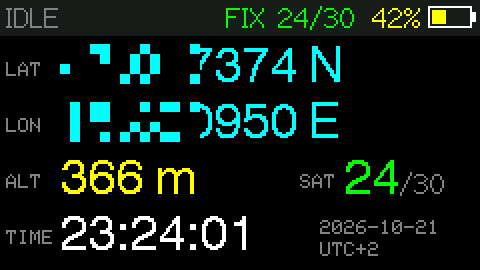
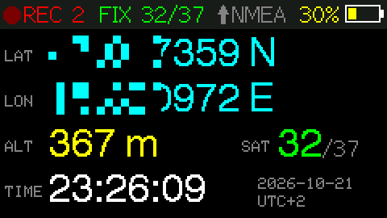
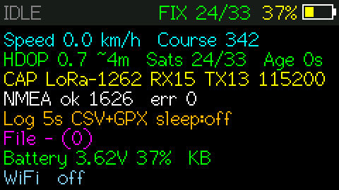
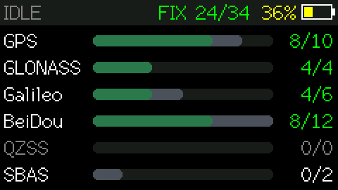
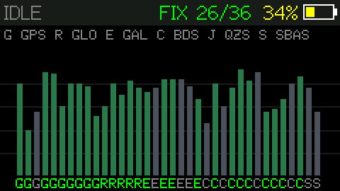
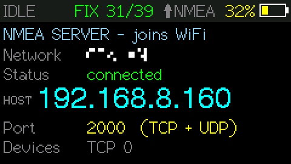
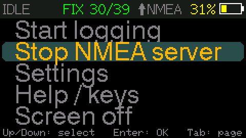

# Cardputer GPS Logger / NMEA Server

GPS track logger and **WiFi NMEA server** for the **M5Stack Cardputer ADV** (also runs on
Cardputer v1.x).

- **Logger:** logs to micro SD as CSV and/or GPX, shows position, altitude, speed, time and
  satellites in large colored digits, and uses deep sleep between points to save battery.
- **NMEA server:** turns the Cardputer into a wireless GPS for phones, tablets and PCs: the
  NMEA sentences are sent over WiFi (TCP + UDP) to chart and navigation apps like Garmin
  Boating - in its own WiFi network or in an existing one. Works at the same time as
  logging (deep sleep is off while the server runs). See [NMEA server](#nmea-server-for-eg-garmin-boating-app) below.

## Features

- NMEA server over WiFi (TCP + UDP) for chart apps like Garmin Boating, either with its
  own WiFi network or in the strongest of up to three known networks (own network as fallback)
- Web page while WiFi is on: live GPS data, all track files for download and the settings,
  in any browser
- Large display: latitude, longitude, altitude, local time, satellites (used / in view)
- Status bar: recording state + point count, satellite reception (FIX / NO FIX, used / in
  view), NMEA server (`↑ NMEA`), missing SD card, yellow sun while the screen is kept on
  (`Z`), battery level (percentage left out if the bar is full)
- Big page: speed, direction (degrees and N / NE / E ...) and altitude in large letters
- Details page: speed, course, HDOP with a rough accuracy estimate (HDOP x 5 m), fix age,
  NMEA statistics, log file, battery voltage
- Satellites page: used / in view per constellation (GPS, GLONASS, Galileo, BeiDou, QZSS,
  SBAS) as bars, green = used in the fix
- Signal page: signal strength (SNR, dB-Hz) of every satellite in view as a bar chart,
  green = used in the fix; letters below the bars: G GPS, R GLONASS, E Galileo,
  C BeiDou, J QZSS, S SBAS
- Acceleration pages (Cardputer ADV, built-in accelerometer): g-g diagram with the current
  acceleration, a 10 s trail and the max per direction, an up / down bar, plus a chart of the
  last 24 s; longitudinal (accelerate / brake), lateral (left / right) and vertical (up /
  down) in g, for cars, bikes or planes; max values reset with
  `X` and at each new track. See [Acceleration](#acceleration)
- Menu page: start/stop logging, start/stop NMEA server, settings, tracks, help, screen off /
  deep sleep - no need to remember key letters
- Tracks page: all track files on the SD card with type and size, newest first; delete them,
  show distance, duration, altitude range, max speed, start / end time and altitude profile,
  or draw the track as a map (CSV and GPX files). Map and profile are colored by altitude or
  speed, switched with `C`
- Current track page: info or map (up / down or `I` / `M`) of the track being recorded, like on the
  tracks page, updated every 5 s
- Maps can be zoomed (`=` / `-`) and panned (arrow keys while zoomed in); the zoomed current
  track map follows the latest position until it is panned
- Time cursor (`[` / `]`) on the altitude profile and the map: shows time, altitude and speed
  of the point; a zoomed map is centered on it
- Logging to `/gpslogger/tracks/YYYYMMDD_HHMMSS.csv` / `.gpx` (UTC time stamps).
  The GPX file is closed after every point, so it stays valid if power is lost.
- Optional raw NMEA log (`.nmea` next to the track): all sentences from the GPS,
  buffered in RAM and written in 4 KB chunks (up to 4 KB are lost on power loss)
- Log modes like Garmin: smart (at turns and speed changes), by time (1 s … 1 h) or by
  distance (5 m … 1 km); auto pause while standing still; inaccurate fixes are never
  recorded. See [Log modes](#log-modes)
- Configurable format, time zone (with automatic daylight saving), brightness, timeouts
- RGB LED fades in and out red once a minute while logging (`rec_led`, default on; not
  during deep sleep)
- Deep sleep between points while logging (time mode, interval >= 15 s)
- GPS standby while the accelerometer sees no motion (Cardputer ADV), see
  [GPS standby](#gps-standby)
- GPS module presets plus custom RX/TX pins and baud rate, or automatic baud detection
- Keyboard control when a keyboard is detected (matrix keyboard on v1.x, TCA8418 on ADV);
  without keyboard the G0 button still works
- Configuration stored as a text file on the SD card (`/gpslogger/config.txt`), so it
  survives installing other firmware via the Launcher and can be edited on a PC

## Screenshots

| | |
|---|---|
|  |  |
| **Position:** latitude, longitude, altitude, satellites and local time | **Recording:** blinking `REC` with point count, `↑ NMEA` while the NMEA server runs |
|  |  |
| **Details:** speed, course, HDOP and accuracy, GPS module, log and battery | **Satellites:** used / in view per constellation |
|  |  |
| **Signal:** SNR of every satellite in view, green = used in the fix | **NMEA server:** network, address and port for the app, connected devices |
|  | |
| **Menu:** logging, NMEA server, settings, help, screen off | |

## Supported hardware

| Device                         | Notes                                                     |
|--------------------------------|-----------------------------------------------------------|
| M5Stack Cardputer ADV          | main target; keyboard via TCA8418, CAP LoRa-1262 GPS on the EXT header |
| M5Stack Cardputer v1.0 / v1.1  | matrix keyboard; GPS on the Grove port                    |

The model is detected at runtime, one firmware image runs on all of them. The firmware is
built for the ESP32-S3 (StampS3, 8 MB flash) and uses the Cardputer's display (240 x 135),
SD card slot, battery ADC and keyboard pins, so it does not run on other M5Stack or
ESP32 devices without changes. A micro SD card is needed for logging and for saving the
settings.

## Supported GPS modules

| Preset            | RX | TX | Baud   | Notes                                    |
|-------------------|----|----|--------|------------------------------------------|
| CAP LoRa-1262     | 15 | 13 | 115200 | Cardputer ADV only (EXT header), default on ADV |
| Unit GPS v1.1     | 1  | 2  | 115200 | AT6668, Grove port, default on v1.x      |
| Unit GPS AT6558   | 1  | 2  | 9600   | older M5 GPS unit, Grove port            |
| Grove NMEA        | 1  | 2  | auto   | NEO-6M / NEO-M8N / other NMEA modules     |
| Custom            | any| any| any    | set pins and baud in the settings         |

RX/TX are seen from the Cardputer (Cardputer RX <- GPS TX). Any module that outputs
standard NMEA (GGA/RMC, GSV for satellites in view, GSA for satellites used) over UART
should work.
On Cardputer v1.x, pins 13/15 belong to the keyboard matrix - use the Grove port there.

## Build & flash

Requires [PlatformIO](https://platformio.org/).

```sh
pio run                 # build
pio run -t upload       # flash directly via USB
pio device monitor      # serial log
```

Every build writes two files to `dist/`:

- `GPS-NMEA-Logger.bin` - application image for the **Launcher**
- `GPS-NMEA-Logger-full.bin` - merged image to flash at offset `0x0` (esptool, M5Burner, web flasher)

The firmware version is set in `src/version.h`, shown on the help page (`H`) and written
to the `creator` attribute of GPX files.

## Start via the Launcher

1. Copy `dist/GPS-NMEA-Logger.bin` to the SD card.
2. On the Cardputer start [Launcher](https://github.com/bmorcelli/Launcher), choose
   *SD*, select `GPS-NMEA-Logger.bin` and install it.
3. **Important for deep sleep:** in the Launcher settings untick
   **"DeepSleep starts Launcher"**. Otherwise every wake-up from deep sleep opens the
   Launcher instead of returning to the logger.

## Keys

| Key (keyboard)     | Action                                  |
|--------------------|-----------------------------------------|
| `Enter` / `R`      | start / stop logging                    |
| `,` `/` (left / right), `Tab` | previous / next main page |
| `;` `.` (up / down) | previous / next sub page of the main page |
| `1` ... `6`        | jump to main page, showing its sub page selected last |
| `I` / `M` / `C`    | current track and track pages: info / map / colors by altitude or speed |
| `=` / `-`          | map: zoom in / out (x1 ... x64); zoomed in, the arrow keys pan the map |
| `` ` `` (Esc)      | zoomed map: back to the whole track (arrow keys switch pages again) |
| `F`                | zoomed current track map: follow the latest position again after panning |
| `[` / `]`          | track info and map: time cursor back / forward (first press: `[` at the end, `]` at the start); `{` / `}` (Shift) jump 10 % of the track; `` ` `` hides it |
| `C` / `X`          | acceleration pages: calibrate (standing still) / reset max values |
| `;` `.` + `Enter`  | menu page: select item (up/down arrow keys) and run it |
| `S`                | settings (`;` `.` select, `,` `/` change, `` ` `` / `Del` save & exit) |
| `T`                | tracks (`;` `.` select, `Enter` actions: info / map / delete; shortcuts `I` `M` `D`, `` ` `` / `Del` back) |
| `H`                | help                                    |
| `Z`                | screen off now (or deep sleep, if active); while the screen is off: screen on and it stays on, e.g. on USB power (until the next `Z` or restart) |
| `P`                | screenshot of the current page as BMP to `/gpslogger/screenshots/` |
| **G0 click**       | next page, all sub pages in turn / leave settings / help / tracks |
| **G0 hold**        | start / stop logging                    |

Any key turns the screen back on. G0 wakes the device from deep sleep.

Main pages and their sub pages (a bar at the right edge shows the sub page and how many there are):

| Main page          | Sub pages (up / down)                      |
|--------------------|--------------------------------------------|
| 1 Position         | position, big (speed / direction / altitude) |
| 2 GPS              | details, satellites, signal                |
| 3 Track            | info, map of the track being recorded      |
| 4 Acceleration     | g-g diagram, chart (Cardputer ADV only)    |
| 5 WiFi             | NMEA server (only while it is on)          |
| 6 Menu             | menu                                       |

## Configuration

Changed in the settings page or by editing `/gpslogger/config.txt` on the SD card
(it is created with defaults on first start):

```ini
gps_module=cap_lora1262   # cap_lora1262 | unit_gps_v11 | unit_gps_at6558 | grove_nmea | custom
gps_rx=15
gps_tx=13
gps_baud=115200           # or auto
log_mode=Smart            # Smart | Time | Distance
log_interval=5            # seconds (time mode)
log_distance=10           # meters (distance mode)
auto_pause=1              # 1 = no points while standing still
log_format=CSV+GPX        # CSV | GPX | CSV+GPX
nmea_log=0                # 1 = also log raw NMEA to .nmea
deep_sleep=0
screen_timeout=60         # seconds, 0 = never
fix_timeout=60            # max. seconds to wait for a fix after deep sleep wake-up
tz_offset=0               # added to UTC for the display: hours or hours:minutes (+5:30)
dst=EU                    # off | EU | US: +1 h during daylight saving time
auto_start=0              # start logging after power on
brightness=128
rec_led=1                 # 1 = RGB LED pulses red once a minute while logging
map_color=altitude        # altitude | speed: colors of track map and profile
nmea_server=0             # 1 = send NMEA over WiFi
wifi_mode=ap              # ap = own network, client = join the strongest known network
wifi_ssid=                # known networks for client mode, 1 to 3
wifi_pass=
wifi_ssid2=
wifi_pass2=
wifi_ssid3=
wifi_pass3=
ap_ssid=GPS-NMEA-Logger
ap_pass=k7rmx2qhwa        # random on first start; empty = open network, else min. 8 characters
nmea_port=2000            # TCP server and UDP broadcast port
gps_standby=0             # 1 = GPS to standby while not moving (Cardputer ADV)
imu_up=0,0,0              # accelerometer calibration, set with C on the acceleration pages
imu_fwd=0,0,0
imu_fwd_learned=0
```

WiFi names and passwords can also be typed in the settings page: select the entry, press
`Enter`, type, `Enter` to accept (`Del` deletes, G0 cancels). They are stored in plain text
in `config.txt`. All settings can also be changed on the web page (see below).

## NMEA server (for e.g. Garmin Boating app)

With `nmea_server=1` the Cardputer sends every NMEA sentence from the GPS over WiFi:
to all TCP clients connected to `nmea_port` (up to 4) and as UDP broadcast to the same port.

- **Own network** (`wifi_mode=ap`): join the WiFi `GPS-NMEA-Logger` with the iPad, using the
  password shown on the WiFi page (generated randomly on first start, stored as `ap_pass`).
  The Cardputer has the address `192.168.4.1`.
- **Existing network** (`wifi_mode=client`): the Cardputer scans for the networks
  `wifi_ssid`, `wifi_ssid2` and `wifi_ssid3` and joins the one with the strongest signal;
  its address is shown on the WiFi page. If that fails, it tries the next one; networks
  missing in the scan are tried too (hidden networks). If none of them can be joined after
  trying all (at least 30 seconds), it opens its own network instead (as with `wifi_mode=ap`, shown as *fallback* on the WiFi
  page). It stays there until the server is restarted (menu or settings). A lost connection
  starts a new search, so it may switch to another known network. Each failed attempt is
  shown in the status line with the reason, e.g. `MyWiFi: wrong password?`. The Cardputer
  only supports 2.4 GHz networks.

The NMEA sentences contain your position: every device that can reach the port gets it,
and in client mode the UDP broadcast sends it to every device in that network. Use the own
network, or a WiFi you trust.

In the Garmin Boating app: *Menu > Paired devices > + > Add device*, enter
host = the address above, port = `nmea_port` (default 2000) and TCP or UDP.

While the server runs, the status bar shows **↑ NMEA**: orange = no network yet,
grey = no device, green = connected devices (TCP clients; in AP mode also
devices that joined the network - pure UDP listeners in client mode can't be detected).
The WiFi page (after the signal page) shows network name, AP password or connection
status, address, port and connected devices. Deep sleep is disabled while the server is
on, and WiFi increases the power consumption considerably.

### Web page: GPS data and track download

While the NMEA server runs, the Cardputer also serves a web page on port 80: open
`http://192.168.4.1/` (own network) or `http://<address from the WiFi page>/` in any
browser. It shows the current GPS data (refreshed every 2 s) and lists all track files
with type and size; tap a file to download it. Logging goes on meanwhile, but while a
large file is sent, the display and the NMEA output pause for a moment.

The **Settings** link opens all entries of `config.txt` as a form, with the same
explanations as in the file. *Save* stores them on the SD card and applies them right away;
if WiFi settings changed, the network restarts and you need to reconnect. Passwords are
never shown: leave a password field empty to keep the stored one (so an open own network,
`ap_pass` empty, can only be set on the Cardputer or in the file).

Like the NMEA sentences, the page is open to every device in the network - including the
settings, so anyone there can change them.

### Testing from a computer

Join the same WiFi as the Cardputer, then:

```sh
# TCP (use the address from the WiFi page in client mode)
nc 192.168.4.1 2000

# UDP broadcast (brew install socat)
socat -u UDP-RECV:2000 -
```

Don't use `nc -ul 2000` for UDP: macOS netcat ties its socket to the first sender and its
own address, so it drops the following broadcast packets after a few lines.

## Log modes

GPS positions jitter by a few meters even when the device doesn't move. Recording all of
them makes a track zig-zag around a stop and adds up distance that was never travelled.
So points are filtered before they are written:

* **Accuracy**: a fix with HDOP above 5 (roughly 25 m) is never recorded.
* **Smart** (default): a point at turns (course change >= 20°) and speed changes
  (>= 5 km/h and >= 25 %), and at least every 60 s or 200 m. Moves smaller than
  5 m or the fix accuracy (HDOP x 5 m) are ignored as noise.
* **Time**: a point every `log_interval` seconds.
* **Distance**: a point every `log_distance` meters.
* **Auto pause** (default on, all modes): after 10 s below 1.5 km/h recording pauses
  (status bar shows `PAUSE`) and resumes above 3 km/h or after moving more than 20 m.

## Acceleration

The Cardputer ADV has an accelerometer (BMI270); v1.x has none, there the two pages are
left out. To measure in a car, fix the Cardputer (e.g. on the dashboard, any tilt), stand
still and press `C` on the g-g or chart page: this measures which way is up. Forward is then
learned from the GPS while driving: the acceleration that goes along with the speed changes
points forward. Until that happened (a few speed-ups / brakings, the pages show
`learning fwd`) longitudinal and lateral are mixed up. The calibration is stored in
`config.txt`; press `C` again after moving the Cardputer.

Values are 100 ms averages, smoothed, without gravity:

* **Lon**: + = accelerating, - = braking. **Lat**: + = to the right, - = to the left.
  **Vert**: + = up, - = down.
* **Max**: accel / brake, left / right, up / down; reset with `X` and when a new track starts.
* **g-g diagram**: red dot = now, grey = last 2 s, orange = max per direction. Scale 0.5,
  1 or 2 g, whichever holds the max values. The bar right of it shows vertical (magenta = now,
  orange = max up / down) with its own scale, written below it.
* **Chart**: lon (cyan), lat (yellow) and vertical (magenta) of the last 24 s; below it the
  max values (`A` accel, `B` brake, `L` left, `R` right, `U` up, `D` down).
* **CSV tracks** get five more columns: `accel_g`, `brake_g`, `lateral_g`, `up_g`, `down_g`
  = max since the previous point (empty without calibration).
* **Web page**: current and max values in the GPS table.

All axes are fixed to the vehicle as calibrated, not to the ground. In a plane, calibrate
on the ground: vertical then is the load factor minus 1 (+1 g in a 60° level turn, where a
pilot reads 2 g). Pitched, gravity shows in lon (about 0.17 g at 10° pitch); banked, it
shows in lat, except in a coordinated turn.

## GPS standby

With `gps_standby=1` (Cardputer ADV) the accelerometer watches for motion. After 30 s
without motion, while the GPS also reports less than 1.5 km/h (or has no fix), the GPS
module is put into standby for 15 s (`$PCAS12` command of CASIC modules: ATGM336H on the
CAP LoRa-1262, AT6668, AT6558), again each time it wakes up, until motion starts. The status
bar shows `GPS STBY`, logging is paused. The module can't be woken early, so after starting
to move it takes up to 15 s plus a hot fix (1-2 s) until positions come again.

Not all module versions support the command: if the GPS keeps sending, standby is switched
off until the next start (settings show `on (unsupported)`). It is not used with the NMEA
server on or while deep sleep is active. The motion thresholds are first estimates; the
`vib` value on the acceleration pages (shown until calibrated) is the measured vibration.

## Deep sleep

With `deep_sleep=1`, logging active in time mode and an interval of at least 15 s, the device goes
to deep sleep after `screen_timeout` seconds without input. It then wakes up by timer for
each point, reads the GPS (display stays off), writes the point and sleeps again. If no fix
is found within `fix_timeout` seconds, that point is skipped. Press **G0** to get the UI back.

The GPS module itself stays powered so it keeps a hot fix; it consumes far more power than
the sleeping ESP32 (typically 20-40 mA), so longer intervals save mainly the display and CPU
power. With intervals below 15 s only the screen is switched off.

## Battery Life

From fully loaded battery to the last entry written in the log files:

* log every 5 seconds, write csv and gpx, deep sleep off: 6h 15min

| log interval | logs     | deep sleep | duration |
| ------------ | -------- | ---------- | -------- |
|  5 sec       | csv, gpx | off        | 6h 15min |
| 30 sec       | csv, gpx | off        | 7h 25min |